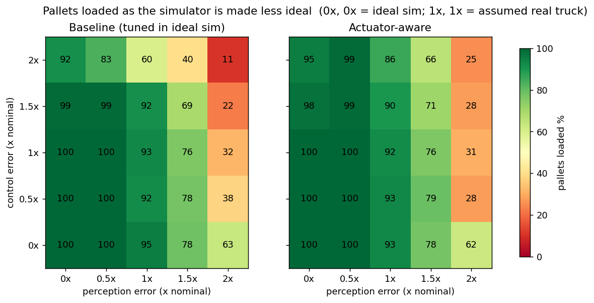
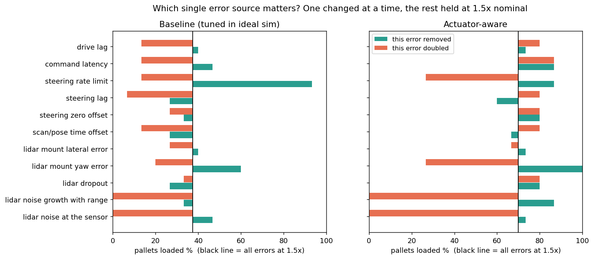
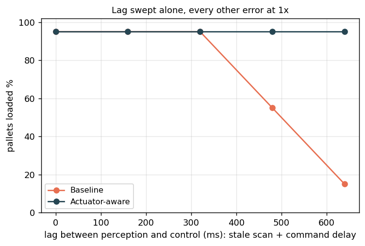
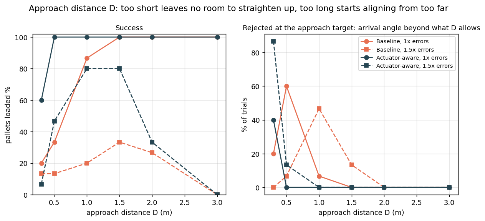
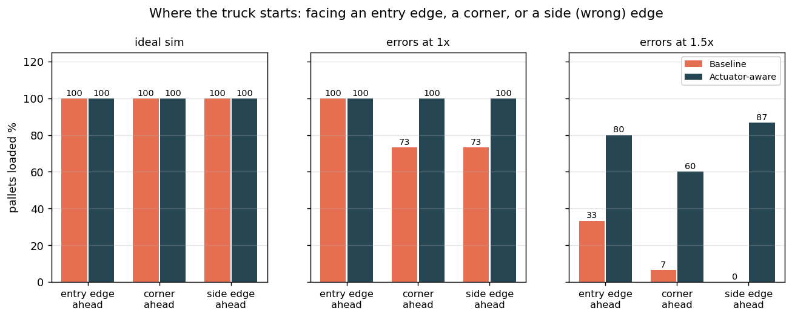
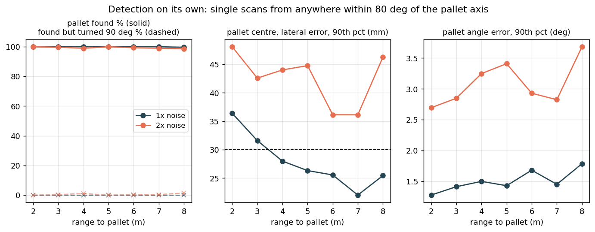
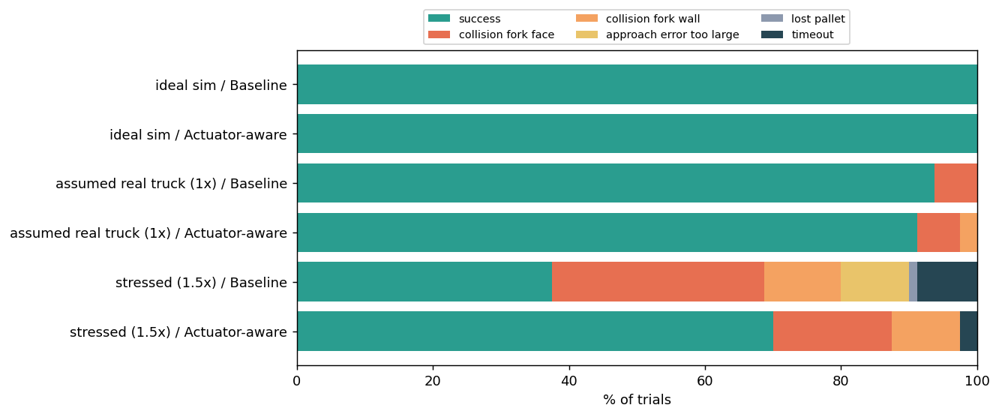
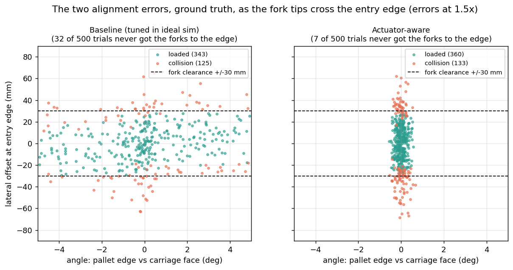

# forksim: when does the simulator lie about a pallet pickup?

**[Run the simulator in your browser](https://bakbik.github.io/forksim/)** (nothing to install; first load fetches about 10 MB)

A small 2D simulator of an autonomous pallet truck that finds a pallet with
lidar, drives to it and loads it. It was built to answer one question:

> The ideal simulator says the pickup always works. Which departures from ideal
> break it first, perception or control, and how much of each can it take?

**Short answer, from 2,610 simulated pickups:** the ideal simulator loads the
pallet every time and cannot tell a naive controller from a careful one. With
the error levels I assumed for a real truck both still load about 93 %. Push
the errors to one and a half times that and they split: the naive controller
drops to 38 %, the careful one holds 70 %. What breaks the naive one is the
steering actuator being slow. What limits the careful one is the lidar: where
it is mounted, and how noisy it is at range. Lag between perception and control
does nothing up to about 0.3 s and is then a cliff, unless the controller
compensates for it. [Details below.](#results)

The same Python package runs the browser demo, the batch experiments and the
tests. There is one implementation, not a demo and a "real" one.

- [Try it](#try-it)
- [What is simulated](#what-is-simulated)
- [Allowed inputs](#allowed-inputs)
- [The task, step by step](#the-task-step-by-step)
- [How a run is judged](#how-a-run-is-judged)
- [Sources of error](#sources-of-error)
- [Architecture](#architecture)
- [The experiment](#the-experiment)
- [Results](#results)
- [Limitations](#limitations)
- [What I would measure on a real forklift](#what-i-would-measure-on-a-real-forklift)
- [Using it from Python](#using-it-from-python)
- [Repository layout](#repository-layout)

## Try it

### In the browser

Open **<https://bakbik.github.io/forksim/>**. The page downloads Python
(Pyodide) and this package, then runs the simulation locally in your tab.

| Tab | What it does |
|---|---|
| **Run** | Pick a driver, press **Start**. *Trial number* selects the situation: the same number always gives the same pallet pose, start pose and hidden errors. *Next trial* moves to a new one. Speed up to 15x. |
| **Properties** | Room size; pallet position, angle, size and weight; truck start pose, max speed, max steer angle, minimum turning radius; approach distance **D**. The allowed range is shown under each field; a value outside it is refused with a reason. *Apply and restart* to use them. |
| **Errors** | Two sliders: how wrong perception is and how badly the truck obeys, from 0 (ideal simulator) through 1 (assumed real truck) to 3. |
| **Batch** | Runs 10 to 40 trials for both drivers with the current settings and tabulates how each ended. |

Drivers:

- **Actuator-aware** and **Baseline** are the two automatic controllers compared in the experiment.
- **Manual** lets you drive. Click the view first, then `↑` `↓` for speed, `←` `→` to steer, hold `Shift` for full lock, which pivots the truck on the spot.

What you are looking at:

| On screen | Meaning |
|---|---|
| Blue dots | Lidar returns from the latest scan, where they really hit |
| Grey dots | Cached map points the truck cannot currently see |
| Green / red lines on the pallet | Its two entry edges (forks go in) and two side edges (they do not) |
| Thick translucent lines | Edges the detector found in this scan, coloured by how it classified them |
| Orange dashed outlines | Where the truck *believes* the pallet is, and the approach target it is heading for |
| Orange bar at the back of the truck | The drive wheel, turned to its current steering angle |
| "truth" vs "robot thinks" | The two alignment errors as they really are, and as the truck estimates them |

Things worth trying: put the pallet at angle 0 so the truck starts facing a
*side* edge and has to work out where the entry edges are; shrink **D** to 0.5 m
and watch the accepted angle shrink with it; push the Errors sliders to 2 and
compare the two drivers in Batch; narrow the pallet to 0.77 m, the tightest fit the forks allow.

### On your machine

```bash
pip install numpy matplotlib pytest
```

```bash
python -m http.server 8765
```

Then open <http://localhost:8765/web/>.

```bash
python -m forksim.experiment
```

Runs every experiment described below (2,610 trials, about 7 minutes on 15
worker processes), writes `results/` and draws the figures. `--seed N` gives a
different but equally reproducible set.

```bash
python -m pytest -q
```

## What is simulated

| Thing | Model |
|---|---|
| **Room** | 20 x 30 m, origin in the bottom-left corner, x right, y up. Four walls, visible to the lidar. No other obstacles. |
| **Pallet** | Static EUR pallet, 1200 x 800 x 144 mm, 400 kg by default. Three stringers with two fork pockets 227.5 mm wide. Position, angle, size and weight are configurable. |
| **Truck** | SEER SFL-CBD15 autonomous pallet truck. From its data sheet: 1712 x 932 mm, forks 1220 x 170 mm at 550 mm outer width, 2 m/s, 1500 kg rated load, 1524 mm turning radius. Derived or assumed: wheelbase 1.2 m, load wheels 0.26 m behind the fork tips, steering lock 90 deg, all actuator dynamics. |
| **Truck motion** | Pallet-truck kinematics: a single wheel under the power unit drives and steers, the forks ride on load wheels, and the truck pivots about the load axle. |
| **Lidar** | One 2D scanner between the forks at block height: 360 deg, 0.25 deg resolution, 10 Hz, 25 m range. Ray cast against the pallet blocks and the walls. |
| **Camera** | Modelled in `sensors.py` but switched off (`CameraSpec.enabled = False`). The truck runs on lidar alone. |

The forks are 170 mm wide and the pockets 227.5 mm, so a fork has **25 mm of
room on each side**. That number sets how hard the task is.

## Allowed inputs

A configuration outside these ranges is rejected before anything runs:
`TrialRunner` raises `ValueError`, the web page refuses to start and says which
value is wrong, and `forksim.validate(cfg)` returns the list of problems.
`forksim.limits(cfg)` returns the ranges for a given configuration, because
several of them follow from other values rather than being fixed numbers.

| Property | Allowed | Why |
|---|---|---|
| Pallet size y (entry edge) | 0.77 to 2.5 m | Lower bound is computed: the forks at their 550 mm outer width, plus both 100 mm outer blocks, plus 10 mm clearance each side. Narrower and the forks cannot enter. Fit 680 mm forks and it becomes 0.90 m. |
| Pallet size x (along forks) | 0.6 to 2.5 m | From a half pallet up to well past any standard one |
| Pallet size z | 0.10 to 0.25 m | Not used by the 2D model |
| Pallet weight | 1 to 1500 kg | Upper bound is the truck's rated load |
| Pallet position | whole pallet at least 0.3 m inside the walls | Follows from room size and pallet size |
| Pallet angle, truck start angle | any | |
| Truck start position | at least 1 m inside the walls, and not on the pallet | |
| Truck max speed | 0.1 to 2.0 m/s | Data sheet maximum |
| Truck max steer angle | 10 to 90 deg | 90 deg is turning on the spot |
| Truck minimum turning radius | 0 to 5 m | |
| Approach distance D | 0.3 to 5 m | |
| Accepted share of possible approach error | 0.1 to 1 | |
| Room | 5 to 100 m each way | |

Inside these ranges every pallet size was checked to load in the ideal
simulator, at both ends of each range and in combination. Valid does not mean
easy: at 0.77 m the forks have 10 mm to spare instead of 25 mm, and with
realistic errors the truck scrapes a block.

## The task, step by step

The truck knows nothing about the room, the pallet's position or even its own
position in the room: odometry starts at zero. Every 100 ms it gets one lidar
scan and nothing else. It may cache scans in a local map, but **a new scan
always replaces whatever was cached where it looked**, so if the world changes
the map follows. The only thing known in advance is what this *type* of pallet
looks like: its edge lengths and block pattern.

### 1. Detect

`perception.py` pulls straight edges out of the points (RANSAC, then a
least-squares polish). Long ones are walls and are discarded. Short ones are
classified:

- **entry edge**: about 800 mm long and its points fall on the
  block-pocket-block-pocket-block pattern;
- **side edge**: about 1200 mm long and solid.

Either kind is enough to place the pallet, because the pallet's centre is half
a pallet behind the edge. An entry edge places it more precisely. The output is
the **pallet's position and angle relative to the truck**. It is a fit to noisy
points, so it is noisy, and that noise feeds everything downstream. Five
consistent detections in a row confirm a pallet; after that the estimate keeps
being updated for the rest of the run.

### 2. Approach

The pallet has two right edges and two wrong ones. The truck picks the nearer
entry edge whose approach target is clear and reachable in a straight line
without cutting through the pallet. The **approach target** is the point a
distance **D** in front of that edge's centre (fork tips to edge), facing it
squarely.

There are no obstacles, so the trajectory is the most trivial one this truck
can do: **turn on the spot, drive straight, turn on the spot.**

On arrival the truck has some positioning error. The phase is accepted only if
that error is small enough for the next phase to close. The limit is not a
tuned number. Given D, the truck's minimum turning radius R and the lateral
offset on arrival, `behaviors.acceptable_angle` works out the largest yaw error
that can still be removed: straightening up costs `R·sin(ψ)` of the distance and
carries the truck `R·(1−cos ψ)` further sideways, and what is left of D must be
enough for an S-curve to remove the total sideways offset. A share of that
kinematic limit (half, by default) is accepted.

| D | Accepted yaw error, no lateral offset | with 50 mm lateral offset |
|---|---|---|
| 0.5 m | 3.9 deg | rejected |
| 1.0 m | 7.9 deg | 5.7 deg |
| 1.5 m | 11.9 deg | 10.6 deg |
| 2.5 m | 20.9 deg | 20.0 deg |

A small D forces tiny errors. A large D gives the align phase room to settle
but leaves less freedom in where the approach can end.

### 3. Align

The truck closes the two remaining errors **while driving in**, never turning
tighter than R:

- **lateral offset** between the pallet's centre line and the fork centre line;
- **angle** between the pallet's entry edge and the truck's carriage face.

Perception stays in the loop until the scanner is 0.35 m from the edge, where
it can no longer frame it. The phase ends when the pallet touches the carriage.
That contact, with both forks in their pockets, is the one allowed contact and
it means the pallet is **loaded**.

### Flags

Any phase can decline to hand over to the next one:

| Flag | Raised when |
|---|---|
| `no_pallet_detected` | Nothing confirmed within 15 s |
| `no_approach_position` | Neither entry edge has a usable approach target |
| `approach_error_too_large` | Arrived at the target with more yaw error than D allows |
| `lost_pallet` | No valid detection for 5 s during align |

### The two controllers

Both run exactly the behaviours above with the same gains.

- **Baseline** is what you get by tuning in the ideal simulator, where steering
  is instant.
- **Actuator-aware** knows the steering has delay, lag and a rate limit. It
  predicts its pose across the delay, and it does not drive until the steered
  wheel has caught up with its command.

Nothing else differs between them.

## How a run is judged

A test is one pickup attempt. It is successful only if every layer accepts in
turn and the run ends with the loading contact, outcome `success`. The first
two layers are judged by the robot on its own estimates. The last is judged by
the evaluator on ground truth, so the robot cannot pass by being wrong about
where it is.

### Acceptance criteria per layer

| Layer | Accepted when | Judged on | Otherwise |
|---|---|---|---|
| **Detect** | An edge counts as an *entry* edge if its length is within 0.12 m of the pallet width and at least 80 % of its points fall on the block-pocket-block pattern; as a *side* edge if within 0.18 m of the pallet length and solid. A pallet is **confirmed** after 5 detections in a row that agree to within 0.3 m and 15 deg. An **approach position exists** if, for at least one entry edge, the spot is free of lidar returns within 0.75 m and reachable in a straight line without passing closer to the pallet than the spot itself. | Robot's detections | `no_pallet_detected` after 15 s; `no_approach_position` |
| **Approach** | **Arrived**: at the target to within 10 mm along track, facing the edge to within 0.5 deg, stopped, wheel straight. **Accepted**: estimated yaw error no larger than half of what align could still close, given D, the minimum turning radius and the estimated lateral offset. At D = 1.5 m: 11.9 deg with no lateral offset, 9.1 deg with 100 mm, 6.2 deg with 200 mm, nothing beyond about 390 mm. | Robot's estimate | `approach_error_too_large` |
| **Align** | **Tracking held**: a detection made from the entry edge itself, within 0.35 m and 20 deg of the tracked pallet, at least every 5 s (the truck holds still after 1 s without one). **Loaded**: the carriage face reaches the entry edge with both fork tips inside their own pockets and no collision on the way. In practice the forks must cross the entry edge within +/-30 mm laterally. | Ground truth | `lost_pallet` after 5 s; any collision |

### Every way a run can end

"Seen" is the count across the 2,610 trials of the main experiment, most of
which ran at error levels well above the assumed ones.

| Outcome | Raised by | Condition | Seen |
|---|---|---|---|
| `success` | Evaluator | Pallet against the carriage, both forks in their pockets | 1,676 |
| `collision_fork_face` | Collision check | A fork overlaps a block by more than 5 mm with its tip less than 80 mm past the entry edge: it missed the pocket sideways | 364 |
| `collision_fork_wall` | Collision check | The same overlap with the tip further in: it entered, then scraped a block | 120 |
| `collision_side` | Collision check | Fork contact while heading more than 45 deg off the pallet axis: it drove at a side (wrong) edge | 1 |
| `collision_body` | Collision check | The power unit overlaps the pallet by more than 5 mm, or the carriage reaches the pallet without the forks in their pockets | 2 |
| `no_pallet_detected` | Detect | Nothing confirmed within 15 s | 30 |
| `no_approach_position` | Detect | Neither entry edge has a usable approach position | 0 |
| `approach_error_too_large` | Approach | Arrival yaw error beyond what D allows | 148 |
| `lost_pallet` | Align | No valid entry-edge detection for 5 s | 13 |
| `timeout` | Evaluator | Not finished after 90 s | 256 |
| `left_room` | Evaluator | The truck's reference point left the room | 0 |

At the assumed error levels (1x, 160 trials) the only failures were fork
collisions: 10 `collision_fork_face` and 2 `collision_fork_wall`. Every other
kind needed errors at 1.5x or more, a short or long D, or a harder start.
`no_approach_position` and `left_room` never occurred in the experiments; each
has a dedicated test instead.

The collision check is deliberately naive: it samples the outline of the forks
and the power unit, tests the points against the pallet, tolerates 5 mm of
overlap and stops the simulation at the first contact that is not the loading
contact.

Every trial also records the two alignment errors as ground truth at three
moments (arrival at the approach target, fork tips crossing the entry edge, end
of run) next to what the truck estimated them to be, plus the error of its last
pallet detection.

Trials are reproducible: `(seed, trial)` fixes the pallet pose, the start pose,
every hidden bias and every noise sample. Trial *k* is the same situation for
both controllers and at every error level, so comparisons are paired.

## Sources of error

Eleven independent parameters, all in `config.py`. `0x` of everything is the
ideal simulator; `1x` is a guess at an uncalibrated real truck. **The 1x values
are assumptions, not measurements.**

| Perception | 1x value | What it is |
|---|---|---|
| Lidar noise at the sensor | 6 mm | Range noise on a beam at zero range |
| Lidar noise growth with range | 3 mm per m | Added per metre of range. Also stands in for the beam spot widening and blurring edges. Together: 9 mm at 1 m, 15 mm at 3 m, 30 mm at 8 m |
| Lidar dropout | 2 % | Beams that return nothing |
| Lidar mount yaw error | 0.5 deg | Scanner not pointing where perception thinks; fixed per trial |
| Lidar mount lateral error | 5 mm | Scanner not sitting where perception thinks; fixed per trial |
| Scan/pose time offset | 60 ms | The scan is older than the pose it is combined with |

| Control | 1x value | What it is |
|---|---|---|
| Steering zero offset | 1 deg | Wheel is not where its encoder says; fixed per trial |
| Steering lag | 0.25 s | First-order response of the steering actuator |
| Steering rate limit | 40 deg/s | Scales inversely: 27 deg/s at 1.5x, 20 deg/s at 2x, none in the ideal simulator |
| Command latency | 0.10 s | Pure delay between command and actuator |
| Drive lag | 0.40 s | First-order response of the drive |

Truth and odometry are integrated side by side. The steering zero offset turns
the truck without turning its odometry, which is what "it does not drive exactly
where it is told" means here. Wheel slip and wheel-radius error are neglected.

Because lidar noise grows with range, **a closer look is a better look**, and
the pipeline is built to count on that. The detector holds nearby points to a
tight line and far ones to a loose line, and the tracked pallet pose weights
each detection by the range it was made from, so the estimate sharpens as the
truck closes in.

## Architecture

```
            truth                                  what the robot has
  ┌──────────────────────┐
  │ config.py            │   room, pallet, truck, error levels, task (D)
  └──────────┬───────────┘
             ▼
  ┌──────────────────────┐  ranges   ┌────────────┐ points ┌───────────────┐ pallet pose ┌──────────────┐
  │ trial.py TrialRunner │──────────▶│ mapping.py │───────▶│ perception.py │────────────▶│ behaviors.py │
  │  reset / step        │  lidar    │ local map, │        │ edges → entry │             │ detect →     │
  │  collision check     │ sensors.py│ new beats  │        │ or side →     │             │ approach →   │
  │  verdict             │           │ cached     │        │ pallet pose   │             │ align, flags │
  │                      │◀──────────┴────────────┴────────┴───────────────┴─────────────┤              │
  │  vehicle.py          │        drive-wheel speed and steering commands                └──────────────┘
  │  truth + odometry    │
  └──────────────────────┘
        ▲            ▲
  experiment.py    webapi.py ── web/index.html (same package, in the browser)
  report.py
```

The seams are the point of the design:

- **Perception work** lives in `perception.py`. Its contract is points in,
  pallet pose out. `experiment.perception_study` scores it on single scans with
  no truck in the loop, and every trial logs detection error against truth.
- **Control work** lives in `behaviors.py` and `vehicle.py`.
  `OraclePerception` replaces the lidar pipeline with truth plus a chosen noise,
  so a controller can be studied against a known perception error.
- **Everything** goes through the same `TrialRunner`. The web page calls it tick
  by tick; the experiments call it thousands of times. A behaviour that works in
  one works in the other.
- Ground truth never leaks to the robot side. Perception does not know the
  lidar's true mount, the controller does not know the true pose, and the
  evaluator alone decides how a run ended.

Realism was spent where the question needs it: actuator dynamics, an honest
split between truth and odometry, a lidar that is ray cast rather than a pose
with noise added, and extrinsic calibration error. It was not spent on
graphics, 3D, or contact physics.

## The experiment

Error sources are grouped as *perception* and *control* and scaled together:
0x is the ideal simulator, 1x my guess at a real truck, 1.5x "stressed". All
experiments are paired by trial number, so both controllers face identical
situations.

| Experiment | What is swept | Trials per cell |
|---|---|---|
| Headline | Everything at 0x, 1x, 1.5x | 80 |
| Grid | Perception multiplier {0, 1, 1.5, 2} against control multiplier {0, 1, 1.5, 2} | 20 |
| Sensitivity | Everything at 1.5x, then one source at a time removed or doubled | 15 |
| Lag | Stale scan + command delay from 0 to 640 ms, the rest at 1x | 20 |
| Approach distance | D = 0.3, 0.5, 1, 1.5, 2, 3 m at 1x and 1.5x | 15 |
| Start layout | Truck starts facing an entry edge, a corner, or a side edge; at 0x, 1x, 1.5x | 15 |
| Detection alone | Single scans from 1 to 8 m, no truck, noise at 1x and 2x | 100 scans |

2,610 trials, about 7 minutes on 15 worker processes.

**The cells are small.** With 15 to 20 trials a rate is only good to about
+/-20 points, so only large differences below mean anything. The headline rows
(80 trials) are good to about +/-10.

## Results

Seed 0. Regenerate with `python -m forksim.experiment`. Full tables in
[`results/summary.md`](results/summary.md), one row per trial in
`results/trials.csv`. Everything is conditional on the assumed 1x error levels.

| Simulator | Controller | Loaded | 95 % CI | Lateral / angle at fork entry (p90) | Mean time |
|---|---|---|---|---|---|
| Ideal (0x) | Baseline | 80 / 80 | 95 - 100 % | 0.2 mm / 0.03 deg | 25 s |
| Ideal (0x) | Actuator-aware | 80 / 80 | 95 - 100 % | 0.3 mm / 0.04 deg | 29 s |
| Assumed real truck (1x) | Baseline | 75 / 80 | 86 - 97 % | 22.6 mm / 2.15 deg | 29 s |
| Assumed real truck (1x) | Actuator-aware | 73 / 80 | 83 - 96 % | 24.2 mm / 0.19 deg | 39 s |
| Stressed (1.5x) | Baseline | 30 / 80 | 28 - 49 % | 33.1 mm / 12.6 deg | 46 s |
| Stressed (1.5x) | Actuator-aware | 56 / 80 | 59 - 79 % | 36.2 mm / 0.28 deg | 61 s |

The forks have 30 mm of room each side (25 mm clearance plus the 5 mm contact
tolerance).



### 1. The ideal simulator says 100 % and cannot tell the controllers apart

80 of 80 for both, in every start layout. It gives no warning of anything below.

### 2. At the assumed error levels the two controllers are still equal

94 % and 91 %. The improvement arrives far straighter (0.19 deg against 2.15 deg
at fork entry) but both end up with the same 23 mm lateral error at the forks,
and lateral error is what decides a pickup. It costs 10 seconds.

### 3. Past that, they split, and for different reasons

Reading the grid along each axis with the other held ideal:

| | 0x | 1x | 1.5x | 2x |
|---|---|---|---|---|
| Control error only, baseline | 100 % | 100 % | 50 % | 25 % |
| Control error only, actuator-aware | 100 % | 100 % | 100 % | 100 % |
| Perception error only, baseline | 100 % | 95 % | 75 % | 60 % |
| Perception error only, actuator-aware | 100 % | 95 % | 75 % | 55 % |

The baseline is broken by **control** error. The actuator-aware controller is
immune to control error across the whole range tested and is limited only by
**perception**, exactly as much as the baseline is.

### 4. Which error sources carry it



Everything at 1.5x, one source changed. Cells of 15, so only the big moves count:

| Change | Baseline (38 %) | Actuator-aware (70 %) |
|---|---|---|
| Steering rate limit removed | **93 %** | 87 % |
| Lidar mount yaw error removed | 60 % | **100 %** |
| Lidar mount yaw error doubled | 20 % | 27 % |
| Either lidar noise term doubled | **0 %** | **0 %** |
| Steering lag doubled | 7 % | 80 % |
| Command latency doubled | 13 % | 87 % |

- **The baseline's problem is the steering rate limit.** A wheel that slews at
  27 deg/s cannot follow commands tuned for an instant one. Remove that single
  limit and the baseline recovers to 93 %.
- **The actuator-aware controller's problem is where the lidar points.** Remove
  the mounting yaw error and it loads every pallet. A scanner 0.5 deg off places
  a pallet 2 m away 17 mm to the side, identically in every scan, so looking
  again does not help.
- **Lidar noise is a cliff.** Doubling either noise term from the 1.5x level
  takes both controllers to zero: the truck cannot confirm or hold a pallet at
  all (`no_pallet_detected`, timeouts). The detector is tuned to the data-sheet
  noise; at three times that it stops working rather than degrading.

### 5. Lag between perception and control: nothing, then a cliff



| Stale scan + command delay | Baseline | Actuator-aware |
|---|---|---|
| 0 ms | 95 % | 95 % |
| 160 ms (assumed) | 95 % | 95 % |
| 320 ms | 95 % | 95 % |
| 480 ms | 55 % | 95 % |
| 640 ms | 15 % | 95 % |

I expected lag to be the main issue. At the lag I assumed it is not an issue at
all: removing it entirely changes nothing. But it is not a slope either. Between
320 and 480 ms the uncompensated controller falls off a cliff, and a controller
that predicts across the delay is untouched to at least 640 ms. So the real
question about lag is which side of the cliff a truck is on, and that can only
be answered by measuring it.

### 6. Approach distance D has a sweet spot



| D | Baseline 1x | Actuator-aware 1x | Baseline 1.5x | Actuator-aware 1.5x |
|---|---|---|---|---|
| 0.3 m | 20 % | 60 % | 13 % | 7 % |
| 0.5 m | 33 % | 100 % | 13 % | 47 % |
| 1.0 m | 87 % | 100 % | 20 % | 80 % |
| 1.5 m | 100 % | 100 % | 33 % | 80 % |
| 2.0 m | 100 % | 100 % | 27 % | 33 % |
| 3.0 m | 100 % | 100 % | 0 % | 0 % |

- **Too short** and the accepted arrival angle shrinks until the approach is
  rejected (`approach_error_too_large`): at D = 0.3 m and 1.5x, 13 of 15
  approaches by the actuator-aware controller were turned away.
- **Too long** fails differently, and only when errors are high: every failure
  at D = 3 m is a timeout. Alignment starts 4 m from the pallet, where the lidar
  is too noisy to track the entry edge steadily, and the truck spends its 90 s
  waiting for detections.
- So D is a trade between room to straighten up and how good the lidar is at
  that distance. About 1 to 1.5 m here.

### 7. Starting at the wrong edge



| Facing at start | Baseline 1x | Actuator-aware 1x | Baseline 1.5x | Actuator-aware 1.5x |
|---|---|---|---|---|
| Entry edge | 100 % | 100 % | 33 % | 80 % |
| Corner | 73 % | 100 % | 7 % | 60 % |
| Side (wrong) edge | 73 % | 100 % | 0 % | 87 % |

Starting in front of a side edge, the truck has to place the pallet from the
wrong edge, work out where the entry edges are and drive round. At 1x the
actuator-aware controller does it every time. The longer manoeuvre is where
the baseline loses pickups even at 1x, the one place the two differ at the
assumed error levels.

### 8. A closer look is a better look



Single scans, no truck, looking at an entry edge roughly head on, 1x noise:

| Range | 8 m | 6 m | 4 m | 2 m | 1 m |
|---|---|---|---|---|---|
| Lateral error (p90) | 45 mm | 34 mm | 20 mm | 11 mm | 9 mm |
| Angle error (p90) | 3.3 deg | 3.1 deg | 1.8 deg | 0.8 deg | 0.4 deg |

At 8 m one scan is worse than the 30 mm fork clearance; at 1 m it is three times
better than it. The pickup works because the truck keeps looking as it closes
in and trusts the near looks most. The pallet is found in 95 % of scans or more
at 1x, and mistaken for one turned 90 deg in at most 1 %.

### 9. Which half of the improvement does the work

The improvement is two mechanisms: **predicting the pose across the delay**, and
**waiting for the steered wheel** before driving. Each alone, both, and neither,
on the same trials (`python -m forksim.ablation`, 400 trials):

| Condition | Neither | Delay prediction only | Wheel waiting only | Both |
|---|---|---|---|---|
| Lag 480 ms, rest 1x | 55 % | 95 % | 95 % | 95 % |
| Lag 640 ms, rest 1x | 15 % | 95 % | 90 % | 95 % |
| Side edge ahead, 1x | 60 % | 95 % | 95 % | 95 % |
| Control 2x, perception ideal | 25 % | 40 % | 100 % | 100 % |
| All errors 1.5x (40 trials) | 32 % | 60 % | 78 % | 68 % |

| Mean time per pickup | Neither | Delay prediction only | Wheel waiting only | Both |
|---|---|---|---|---|
| Lag 640 ms | 47 s | 34 s | 65 s | 48 s |
| All errors 1.5x | 43 s | 36 s | 60 s | 61 s |

- **Against lag, either mechanism is enough**, and prediction is the cheap one:
  it restores 95 % and is faster than doing nothing, where waiting costs 20 to
  30 seconds a pickup.
- **Against slow steering, only waiting works.** Prediction alone gets 40 %
  with control errors at 2x; waiting gets 100 %.
- **Together they are no more successful than waiting alone**, but the truck
  arrives straighter and, when lag is the problem, sooner.

I had guessed the wheel-waiting did nearly all of it, including the immunity to
lag. That was half right: it is the one that cannot be left out, but prediction
handles lag by itself and does it for free. Cells of 20, so differences under
about 20 points (78 % against 68 % in the last row) are not established.





### So, when does the simulator lie?

When it is ideal, it lies by omission: 100 %, two controllers ranked equal,
and no hint of any of the above. And the lie is not one of degree. Several of
these effects are cliffs (lag past 0.3 s, lidar noise past the detector's
tolerance, steering slower than the controller assumes), so a simulator that
is "a bit optimistic" does not give a result that is a bit optimistic. It
gives the right answer until the real number crosses a threshold, and then a
completely wrong one. Which side of each threshold a real truck sits on is
what has to be measured.

## Limitations

What the simulation does not capture, and what it should not be trusted for.

- **The 1x error levels are assumed, not measured.** Every success rate is
  conditional on them. The *shape* of a result (what breaks first, where the
  cliff is) is more trustworthy than any percentage.
- **Contact is geometry, not physics.** No friction, no pallet sliding, no fork
  flex, no chamfered fork tips riding into a pocket. A real pallet forgives a
  few millimetres of scrape and punishes a hard hit by moving; here both are
  "overlap over 5 mm". Nothing after first contact is modelled.
- **It is flat.** No fork height, no mast, no pallet tilt, no uneven floor. A
  fork that is laterally perfect but 20 mm low still fails in reality.
- **The pallet is clean and alone.** Straight blocks, no shrink wrap, no broken
  boards, no neighbouring pallets, no people. The edge classifier would need
  rethinking for a pallet standing against another one.
- **The lidar is idealised in kind, not only in degree.** No beam divergence,
  no mixed pixels at block edges, no reflectivity effects, no motion distortion
  within a scan, no truck body blocking part of the 360 deg view. Range noise
  is white; real range errors are partly systematic per surface.
- **Odometry is encoders only, and wheel slip and wheel-radius error are
  neglected.** No gyro, no SLAM. The real truck's data sheet claims +/-10 mm and
  +/-1 deg localisation; that is not modelled.
- **Lidar noise is a single range-dependent term.** It stands in for range
  noise and for the beam spot blurring edges. Surface reflectivity and angle of
  incidence are not modelled.
- **The experiment cells are small** (15 to 20 trials), one seed, one room.
- **Some truck numbers are derived, not specified**: wheelbase, load-wheel
  position, steering lock and all actuator dynamics.
- **The baseline is deliberately naive.** It shows what the ideal simulator
  fails to warn about; it is not a claim about any production controller.
- **Lifting is not simulated.** "Loaded" means in position. Pallet weight is
  checked against the truck's rated load as an input limit and otherwise has no
  effect; pallet height has none.

Reasonable uses: ranking error sources, finding which tolerance is the tight
one, comparing two controllers on identical situations, regression-testing
behaviour logic. Not reasonable: quoting an absolute success rate, anything
about contact forces, sign-off.

## What I would measure on a real forklift

Several results above are cliffs. The simulator is right on one side of each
and badly wrong on the other, so the measurements that matter are the ones that
say which side a real truck is on.

1. **Lag between perception and control, end to end.** How old a scan is when
   it is used, plus how long a command takes to reach the wheels. Flash a target
   or bump the truck and time when the scan, the command and the wheel each
   respond. Below about 0.3 s it did not matter here; above it an
   uncompensated controller lost most of its pickups. The number also has to be
   known for the controller to compensate at all.
2. **Steering response: rate limit and lag.** A step on the steering command
   with the wheel angle logged. The rate limit alone took the naive controller
   from 93 % to 38 %. It is the cheapest measurement on this list.
3. **Lidar mounting error, yaw especially, per truck.** With control handled
   this is what is left: removing it took the better controller from 70 % to
   100 %. It is systematic, so re-estimating cannot average it away. Scan a
   surveyed flat target from several known ranges and fit the offset.
4. **Lidar noise against range, on real pallets.** Log scans of a pallet at
   surveyed distances and fit noise against range. The detector is tuned to an
   assumed noise curve and stops working, rather than degrading, when the real
   one is much worse. This also checks the noise *model*: I assumed one
   range-dependent term, and real edges and dark wood may not behave that way.
5. **The two alignment errors at fork entry, over 50 or more real pickups.**
   Lateral offset and angle between pallet edge and carriage face, measured
   externally as the tips cross the edge. This is the end-to-end check: with 1
   to 4 plugged in, the simulated distribution of these two numbers should match
   the real one. If it does, the success rate becomes believable.

## Using it from Python

```python
import forksim as fs

# one trial: nominal errors, improved controller, situation number 3
r = fs.run_trial(fs.nominal(), "actuator_aware", trial=3)
print(r.outcome, r.entry_lat_mm, r.entry_angle_deg)

# the ideal simulator, and one at 2x perception error with ideal control
fs.ideal()
fs.scaled(perception_scale=2.0, control_scale=0.0)

# change anything by path
cfg = fs.override(fs.nominal(), {
    "pallet.x": 6.0, "pallet.angle_deg": 30.0,
    "task.approach_distance": 1.0,
    "perception.lidar_yaw_bias_sigma_deg": 0.0,
})

# step it yourself (this is what the web page does)
run = fs.TrialRunner(cfg, "baseline", trial=0)
while not run.step():
    pass
print(run.outcome, run.alert)
```

`TrialRunner(cfg, manual=True)` takes `(drive speed, steering angle)` per step
instead of running the behaviours. `perception="oracle"` swaps the lidar
pipeline for truth plus noise.

## Repository layout

```
forksim/
  config.py       every number: room, pallet, truck, error levels, task
  geometry.py     2D poses, ray casting
  vehicle.py      truck motion and odometry, with actuator imperfections
  sensors.py      lidar (camera present but disabled)
  mapping.py      local map; new scans override cached points
  perception.py   lidar points → edges → pallet pose
  behaviors.py    detect → approach → align, flags, the two controllers
  trial.py        one trial: runner, collision check, verdict, metrics
  experiment.py   Monte Carlo experiments
  ablation.py     the two halves of the improvement, separately
  report.py       figures and results table
  webapi.py       bridge used by the web page
web/index.html    the simulator in a browser
tests/            16 checks, about 6 s
```

Built with an AI coding assistant.
